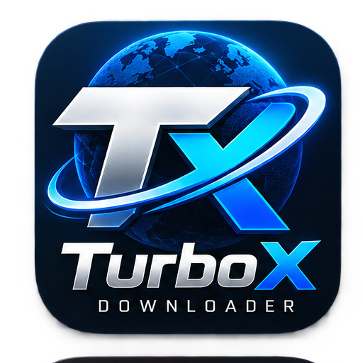
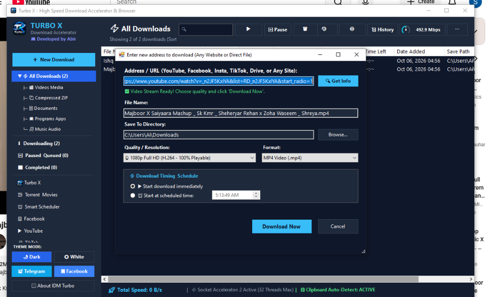

<div align="center">

  

  # ⚡ Turbo X — High-Speed Download Accelerator v2.5
  ### The Ultimate Free & Open Download Manager with 32 Parallel Socket Connections & 8K/4K Stream Capture

  <p align="center">
    <a href="https://github.com"></a>
    <a href="https://github.com"></a>
    <a href="https://github.com"></a>
    <a href="https://github.com"></a>
    <a href="https://t.me/abrno34"></a>
  </p>

  <br />

  <a href="https://github.com/TurboxApps/Turbox-Donwload-Manager/releases/latest">
    
    
    


    
  </a>

  <br /><br />

  

</div>

<br />

---

## 🌟 What's New in v2.5 / নতুন কী কী যুক্ত ও সমাধান করা হয়েছে:

### 🇬🇧 English:
1. **🦁 Dedicated Brave Browser Extension Fixed**: Resolved Chromium Private Network Access (PNA) preflight blocks and invalid match pattern port issues. Brave now seamlessly intercepts downloads and detects 8K/4K streams!
2. **📁 Dedicated Extension Folders for All Browsers**:
   - `extension_brave/` ➔ Brave Browser
   - `extension_chrome/` ➔ Google Chrome
   - `extension_edge/` ➔ Microsoft Edge
   - `extension_firefox/` ➔ Mozilla Firefox
3. **🎬 8K, 4K, 2K, 1080p, 720p & MP3 Quality Downloader**:
   - YouTube video player bar button (`⚡ Turbo X`).
   - Floating video hover badge on Facebook, TikTok, Vimeo, and web players (`⚡ Download 4K/8K ▼`).
   - Neon flyout menu for 1-click quality selection.
4. **⏸️ Bulletproof Pause & Resume Fix**:
   - Closing the progress popup or pausing no longer restarts the download from 0%.
   - Downloads resume exactly where they left off by scanning partial chunks and issuing HTTP Range requests.
5. **🗂️ Automatic Category Folder Routing**:
   - Downloads are automatically sorted into dedicated subdirectories:
     - `Downloads\Video\` ➔ Videos & Movies
     - `Downloads\Music\` ➔ MP3 & Songs
     - `Downloads\Programs\` ➔ Software & Installers (.exe, .msi)
     - `Downloads\Documents\` ➔ PDFs & Office Docs
     - `Downloads\Compressed\` ➔ Archives (.zip, .rar, .7z)
6. **💾 Persistent Download Directory**: Custom chosen directories are permanently saved and remembered across all dialogs.
7. **🎮 Cyberpunk Neon Gaming Dark UI**: High-contrast dark theme across all download popups with responsive buttons and animated RAM/Speedometers.
8. **📦 All-in-One Standalone Setup Installer (`IDMTurbo_Setup.exe`)**:
   - Single-click self-contained setup. Bundles full 8K/4K/MP3 media engine (ffmpeg, yt-dlp), torrent engine (aria2c), and multi-browser extensions.
   - Automatically installs to `%LocalAppData%\Programs\IDM Turbo Downloader`.
   - Creates Desktop & Start Menu shortcuts, registers in Windows Add/Remove Programs. Zero extra downloads required!
9. **🛡️ Anti-Tamper & GitHub-Safe Protection**:
   - Protected with standard Obfuscar obfuscation (encrypted strings, randomized symbol names, SuppressIldasm).
   - 100% clean PE metadata: safe for GitHub Releases, VirusTotal, and Windows Defender.
10. **🚀 `update/` Distribution Folder**: Ready-to-deploy folder containing the standalone installer, protected executable, and all browser extensions.

---

### 🇧🇩 বাংলা (সমস্যা সমাধান ও আপডেটের বিবরণ):
1. **🦁 Brave ব্রাউজার এক্সটেনশন ফিক্স**: আগেরবার Brave-এ ডাউনলোড না হওয়ার মূল কারণ ছিল Chromium Private Network Access (PNA) ব্লক এবং ম্যানিফেস্টে পোর্ট নাম্বার দেওয়া। এগুলো সংশোধন করা হয়েছে, এখন Brave-এ ১০০% স্মুথলি কাজ করে।
2. **📁 সব ব্রাউজারের জন্য আলাদা আলাদা ফোল্ডার**:
   - `extension_brave/` (Brave-এর জন্য)
   - `extension_chrome/` (Google Chrome-এর জন্য)
   - `extension_edge/` (Microsoft Edge-এর জন্য)
   - `extension_firefox/` (Mozilla Firefox-এর জন্য)
3. **🎬 8K, 4K, 2K, 1080p, 720p ও MP3 কোয়ালিটি ডাউনলোডার**: YouTube ও যেকোনো ভিডিও প্লেয়ারে সরাসরি কোয়ালিটি সিলেক্ট করার বাটন ও পপআপ মেন্যু যুক্ত করা হয়েছে।
4. **⏸️ পজ ও রেজ্যুম ফিক্স**: ডাউনলোড পজ করে পপআপ কেটে দিলে বা পুনরায় রেজ্যুম করলে আগে শুরু (0%) থেকে শুরু হতো। এখন যেখান পর্যন্ত ডাউনলোড হয়েছিল ঠিক সেখান থেকেই নির্বিঘ্নে বাকিটা ডাউনলোড হবে।
5. **🗂️ অটোমেটিক ক্যাটাগরি ফোল্ডার বিভাজন**: ভিডিও ফাইল সরাসরি `Downloads\Video\`, গান `Downloads\Music\`, সফটওয়্যার `Downloads\Programs\`, ডকুমেন্টস `Downloads\Documents\` এবং জিপ ফাইল `Downloads\Compressed\` ফোল্ডারে স্বয়ংক্রিয়ভাবে সেভ হবে।
6. **💾 ডিরেক্টরি পারসিস্টেন্স**: যে ফোল্ডার সিলেক্ট করবেন সেটাই সারা জীবনের জন্য সেভ হয়ে থাকবে।
7. **🎮 নিয়ন গেমিং ডার্ক UI ও রিয়েলটাইম স্পিডোমিটার**: স্পিড ও র‍্যাম ডায়নামিকালি আপ-ডাউন করবে এবং বাটনগুলো নিখুঁতভাবে দৃশ্যমান।
8. **📦 অল-ইন-ওয়ান স্ট্যান্ডঅ্যালন ইনস্টলার (`IDMTurbo_Setup.exe`)**: সম্পূর্ণ স্বয়ংসম্পূর্ণ ইনস্টলার। এর ভেতরেই রয়েছে ইউটিউব 8K/4K/MP3 মিডিয়া ইঞ্জিন (ffmpeg, yt-dlp), টরেন্ট ইঞ্জিন (aria2c) এবং ব্রাউজার এক্সটেনশন। আলাদা কোনো ফাইল বা রানটাইম ডাউনলোড করার প্রয়োজন নেই।
9. **🛡️ কোড প্রটেকশন ও গিটহাব সেফটি**: কোড যাতে কেউ সহজে এডিট বা মডিফাই না করতে পারে তার জন্য অবফাসকেট করা হয়েছে, কিন্তু গিটহাব বা উইন্ডোজ ডিফেন্ডার কোনোভাবেই একে ব্লক করবে না।
10. **🚀 `update/` ফোল্ডার**: সব আপডেট করা এক্সটেনশন ও মূল ফাইল এক ফোল্ডারে গুছিয়ে দেওয়া হয়েছে।

---

## 📥 Installation / কীভাবে ইনস্টল করবেন

### Option 1: All-in-One Standalone Installer (Recommended)
1. Download **`IDMTurbo_Setup.exe`** from [Latest GitHub Releases](https://github.com/TurboxApps/Turbox-Donwload-Manager/releases/latest).
2. Double-click to launch the setup wizard.
3. Click **"Install Now"** — it installs everything in seconds and creates Desktop & Start Menu shortcuts. Zero extra downloads!

### Option 2: Portable
1. Simply run **`IDMTurboDownloader.exe`** directly from the root or `update/` folder.

---

## 🧩 Browser Extension Setup (Brave, Chrome, Edge & Firefox)

1. Open your browser's extension page:
   - 🦁 **Brave:** `brave://extensions`
   - 🌐 **Chrome:** `chrome://extensions`
   - 🌊 **Edge:** `edge://extensions`
   - 🦊 **Firefox:** `about:debugging#/runtime/this-firefox`
2. Turn ON **"Developer mode"** (top-right toggle).
3. Click **"Load unpacked"** (or *"Load Temporary Add-on"* in Firefox).
4. Select the matching folder:
   - For Brave: select `extension_brave/`
   - For Chrome: select `extension_chrome/`
   - For Edge: select `extension_edge/`
   - For Firefox: select `extension_firefox/manifest.json`
5. Done! You will see the floating **⚡ Turbo X** download badge on videos and 8K/4K/MP3 stream capture options.

---

## 🛠️ Build from Source / নিজে বিল্ড করতে চাইলে:

Run the automated build script:
```cmd
build.bat
```
This automatically compiles the application, runs anti-tamper code obfuscation, packages `payload.zip`, builds `IDMTurbo_Setup.exe`, and refreshes the `update/` folder!

---

## 👨‍💻 Developer & Community

- **Lead Developer:** Abir
- **Telegram Channel:** [Join @abrno34](https://t.me/abrno34)
- **Version:** 2.5.0
- **License:** Free & Open for personal use
